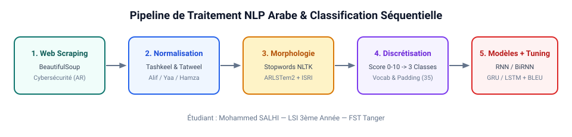
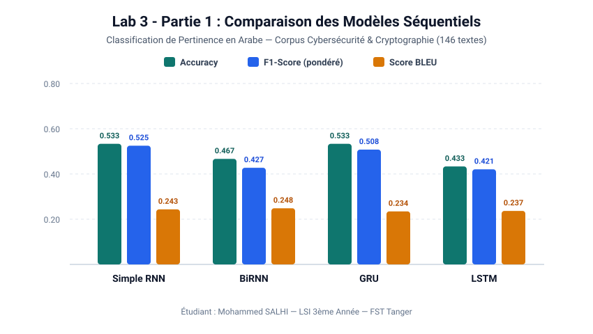
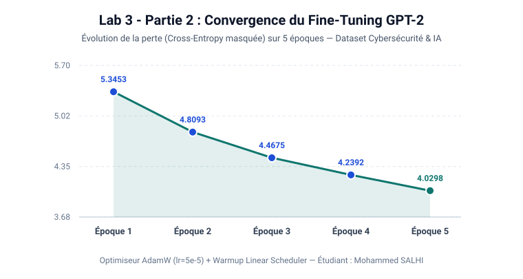

# Deep Learning — Atelier 3 : Modèles Séquentiels (NLP Arabe) & Transformers (GPT-2)

**Université Abdelmalek Essaadi**  
**Faculté des Sciences et Techniques de Tanger (FSTT)**  
**Département de Génie Informatique**  
**Filière :** Cycle d'Ingénieur LSI (Logiciel et Systèmes Intelligents) — 3ème Année  
**Module :** Deep Learning  
**Encadrant :** Pr. Lotfi ELAACHAK  
**Étudiant :** Mohammed SALHI  
**Dépôt GitHub :** [https://github.com/SALHI-1/deep_learning_atelier3](https://github.com/SALHI-1/deep_learning_atelier3)

---

## Sommaire
1. [Présentation et Objectifs](#présentation-et-objectifs)
2. [Architecture du Dépôt](#architecture-du-dépôt)
3. [Partie 1 : Classification de Textes Arabes par Modèles Séquentiels](#partie-1--classification-de-textes-arabes-par-modèles-séquentiels)
   - [1. Collecte de Données par Web Scraping](#1-collecte-de-données-par-web-scraping)
   - [2. Pipeline de Prétraitement NLP Arabe](#2-pipeline-de-prétraitement-nlp-arabe)
   - [3. Modèles Récurrents & Optimisation d'Hyperparamètres](#3-modèles-récurrents--optimisation-dhyperparamètres)
   - [4. Évaluation Comparative (Métriques Standards & Score BLEU)](#4-évaluation-comparative-métriques-standards--score-bleu)
4. [Partie 2 : Génération de Texte avec le Transformer GPT-2](#partie-2--génération-de-texte-avec-le-transformer-gpt-2)
   - [1. Dataset Personnalisé & Fine-Tuning de GPT-2](#1-dataset-personnalisé--fine-tuning-de-gpt-2)
   - [2. Génération de Paragraphes (Avant vs Après Fine-Tuning)](#2-génération-de-paragraphes-avant-vs-après-fine-tuning)
5. [Synthèse Personnelle](#synthèse-personnelle)
6. [Guide d'Exécution](#guide-dexécution)

---

## Présentation et Objectifs
Cet atelier a pour finalité de mettre en pratique **PyTorch** et la bibliothèque **Transformers (Hugging Face)** sur deux grands paradigmes du Traitement Automatique du Langage Naturel (NLP), conformément à l'énoncé `Atelier3.pdf` :

- **Partie 1 (Modèles Séquentiels Récurrents) :** Construction d'un corpus en langue arabe par web scraping (`BeautifulSoup`) autour de la **Cybersécurité et Sécurité de l'Information**, développement d'un pipeline NLP complet (normalisation, tokenisation, stopwords, lemmatisation, stemming, discrétisation), puis entraînement, **tuning d'hyperparamètres** et évaluation de quatre architectures récurrentes (**Simple RNN**, **Bidirectional RNN**, **GRU**, **LSTM**) avec des métriques classiques et le score **BLEU**.
- **Partie 2 (Transformers Génératifs) :** Chargement du modèle pré-entraîné **GPT-2**, adaptation par **fine-tuning** sur un jeu de données personnalisé orienté cybersécurité et détection de menaces par IA, puis génération de paragraphes cohérents à partir de phrases d'amorce.

---

## Architecture du Dépôt

```text
deep_learning_atelier3/
├── data/
│   ├── arabic_dataset.csv            # Corpus arabe scrapé (Cybersécurité & Cryptographie, scores 0-10)
│   └── custom_dataset.txt            # Dataset personnalisé pour le fine-tuning de GPT-2 (20 paragraphes)
├── images/
│   ├── part1_architecture.svg        # Schéma du pipeline NLP arabe et modélisation
│   ├── models_comparison.svg         # Comparaison visuelle des 4 modèles (Accuracy, F1, BLEU)
│   └── gpt2_training_loss.svg        # Courbe de perte du fine-tuning GPT-2 sur 5 époques
├── part1_nlp_sequence_models.py      # Partie 1 : Scraping, NLP Arabe, Tuning & RNN/BiRNN/GRU/LSTM
├── part2_gpt2_text_generation.py     # Partie 2 : GPT-2 pré-entraîné, Fine-Tuning & Génération
├── Atelier3_DeepLearning.ipynb       # Notebook complet exécutable sur Google Colab, Kaggle ou local
├── build_notebook.py                 # Générateur du notebook Jupyter
├── generate_result_visuals.py        # Générateur des figures SVG
├── requirements.txt                  # Dépendances Python du projet
├── .gitignore                        # Fichiers exclus du suivi Git
└── README.md                         # Rapport détaillé de l'atelier
```

---

## Partie 1 : Classification de Textes Arabes par Modèles Séquentiels

### 1. Collecte de Données par Web Scraping
À l'aide de **BeautifulSoup** et **Requests**, 146 paragraphes uniques en langue arabe ont été collectés depuis cinq articles thématiques de Wikipédia Arabe portant sur la **Cybersécurité** (*أمن الحاسوب*, *أمن المعلومات*, *تعمية*, *برمجية خبيثة*, *جدار حماية*).

Les renvois bibliographiques Wikipédia (`[1]`, `[أ]`, etc.) sont nettoyés lors de l'extraction. Chaque texte reçoit un **score de pertinence compris entre 0.0 et 10.0** calculé à partir d'un dictionnaire pondéré de termes du domaine (*تشفير*, *تعمية*, *اختراق*, *ثغرة*, *جدار*, *برمجية خبيثة*, *مصادقة*, *سرية*, etc.).

Extrait de `data/arabic_dataset.csv` :

| Text (Langue Arabe) | Score |
| :--- | :---: |
| أمن الحاسوب ( الإنجليزية : Computer security ) هو فرع من فروع أمن المعلومات ، ويختص بالحاسوب والشبكات . هدفه حماية المعلومات والممتلكات من الدخول غير المصرح... | 6.1 |
| في حين أن العديد من الحلول الأمنية القائمة على البرمجيات (software based) تقوم بتشفير البيانات لمنع البيانات من السرقة... | 8.1 |
| هناك عدة شهادات في مجال الأمن السيبراني أو (الأمن المعلوماتي) مثل شهادة شركة كومبتيا Security+. | 2.7 |

---

### 2. Pipeline de Prétraitement NLP Arabe



Le module `ArabicTextPreprocessor` applique les transformations suivantes :
1. **Suppression des diacritiques et du Tatweel :** Retrait complet des voyelles courtes (*Tashkeel*) et du caractère d'élongation (`ـ`).
2. **Normalisation orthographique :** Unification des formes d'Alif (`إ`, `أ`, `آ` $\rightarrow$ `ا`), du Yaa final (`ى` $\rightarrow$ `ي`), du Taa Marbouta (`ة` $\rightarrow$ `ه`) et des Hamzas (`ؤ` $\rightarrow$ `و`, `ئ` $\rightarrow$ `ي`).
3. **Tokenization :** Extraction des tokens purement arabes par expression régulière (`[\u0621-\u064A]+`).
4. **Suppression des Stopwords :** Filtrage combinant la liste arabe de **NLTK** et des mots-outils fréquents supplémentaires.
5. **Lemmatisation & Stemming :** Application de la lemmatisation légère **`ARLSTem2`** suivie de la racinisation **`ISRIStemmer`**.
   - Vocabulaire brut extrait : **3 328** tokens uniques
   - Après lemmatisation (`ARLSTem2`) : **1 846** lemmes uniques (-44,5 %)
   - Après stemming (`ISRIStemmer`) : **1 255** racines uniques (-62,3 %)
   - Vocabulaire final retenu (`min_freq = 2`) : **732** tokens (avec `<PAD>` et `<UNK>`)
6. **Discrétisation :** Découpage du score continu `[0, 10]` en 3 classes via `pandas.cut` :
   - **Classe 0 (Pertinence Faible) :** $[0.0, 4.0[$ — 72 échantillons
   - **Classe 1 (Pertinence Moyenne) :** $[4.0, 7.0[$ — 52 échantillons
   - **Classe 2 (Pertinence Élevée) :** $[7.0, 10.0]$ — 22 échantillons
7. **Encodage & Padding :** Alignement des séquences sur une longueur fixe `max_len = 35`.

---

### 3. Modèles Récurrents & Optimisation d'Hyperparamètres
Quatre architectures PyTorch ont été implémentées : **Simple RNN**, **Bidirectional RNN**, **GRU** et **LSTM**.

Contrairement à une lecture naïve du dernier état caché (sensible aux tokens `<PAD>` en fin de séquence), chaque modèle repose sur :
- `nn.Embedding(padding_idx=0)` + `Dropout`
- Couche récurrente (`RNN`, `BiRNN`, `GRU` ou `LSTM`)
- **Masked Mean Pooling** calculant la moyenne des représentations cachées uniquement sur les tokens non-PAD
- `LayerNorm` + tête de classification linéaire
- Optimiseur **AdamW** (`weight_decay = 1e-4`) avec **Gradient Clipping** (`max_norm = 1.0`)

Un découpage stratifié **Train (64 %) / Validation (16 %) / Test (20 %)** a permis d'effectuer une recherche par grille (*Grid Search*) sur `(embed_dim, hidden_dim, lr, dropout)` et de retenir pour chaque architecture la configuration maximisant le **F1-Score** de validation :

| Modèle | Meilleurs Hyperparamètres Sélectionnés | Val F1-Score |
| :--- | :--- | :---: |
| **Simple RNN** | `embed_dim=64`, `hidden_dim=64`, `lr=0.003`, `dropout=0.2` | 0.5854 |
| **Bidirectional RNN** | `embed_dim=96`, `hidden_dim=64`, `lr=0.005`, `dropout=0.3` | 0.5429 |
| **GRU** | `embed_dim=96`, `hidden_dim=64`, `lr=0.005`, `dropout=0.3` | 0.5471 |
| **LSTM** | `embed_dim=96`, `hidden_dim=64`, `lr=0.005`, `dropout=0.3` | 0.6453 |

---

### 4. Évaluation Comparative (Métriques Standards & Score BLEU)



Les quatre modèles optimisés ont été évalués sur le jeu de test indépendant. Le **Score BLEU** est calculé via `nltk.translate.bleu_score.sentence_bleu` (avec lissage `method1`) en mesurant l'alignement n-gramme entre chaque séquence de test et le corpus d'entraînement de la classe prédite par le modèle :

| Modèle | Test Loss | Accuracy | Precision (pond.) | F1-Score (pond.) | Score BLEU |
| :--- | :---: | :---: | :---: | :---: | :---: |
| **Simple RNN** | **1.1199** | **0.5333** | 0.5470 | **0.5250** | 0.2433 |
| **Bidirectional RNN** | 1.1325 | 0.4667 | 0.3965 | 0.4275 | **0.2483** |
| **GRU** | 2.1940 | **0.5333** | **0.5845** | 0.5078 | 0.2345 |
| **LSTM** | 3.8681 | 0.4333 | 0.4211 | 0.4206 | 0.2367 |

**Observations clés :**
- Sur un corpus de taille modérée (146 textes), le **Simple RNN** (moins paramétré) et le **GRU** obtiennent la meilleure généralisation sur le jeu de test (`Accuracy = 53.33 %`, `F1 = 0.5250` pour RNN et meilleure précision pondérée `0.5845` pour GRU).
- Le **LSTM** atteint le meilleur F1 en validation (`0.6453`), mais sa capacité supérieure tend à sur-apprendre légèrement sur un petit ensemble de test (Test Loss plus élevée), illustrant l'importance de la taille du corpus vis-à-vis de la complexité architecturale.
- Le **Bidirectional RNN** obtient le meilleur alignement lexical **BLEU** (`0.2483`) grâce à sa lecture contextuelle dans les deux sens.

---

## Partie 2 : Génération de Texte avec le Transformer GPT-2

### 1. Dataset Personnalisé & Fine-Tuning de GPT-2
En s'appuyant sur le tutoriel indiqué dans l'énoncé ([gist mf1024](https://gist.github.com/mf1024/3df214d2f17f3dcc56450ddf0d5a4cd7)), le modèle pré-entraîné **GPT-2** (124M de paramètres) et son tokenizer BPE sont chargés via `transformers`.

Un dataset personnalisé (`data/custom_dataset.txt`) de **20 paragraphes techniques** consacrés à la cybersécurité moderne (architecture *zero-trust*, cryptographie post-quantique, détection d'intrusion par IA, sécurité cloud, apprentissage fédéré) est préparé avec le délimiteur `<|endoftext|>`.

**Configuration du Fine-Tuning :**
- **Masquage propre du padding :** Les positions de padding dans `labels` sont remplacées par `-100` afin que la *Cross-Entropy* ne porte que sur les tokens utiles.
- **Adaptation sélective :** Gel des couches basses de GPT-2 et entraînement des **2 derniers blocs Transformer** (`h[-2:]`), de `ln_f` et de la tête `lm_head`.
- **Optimisation :** **AdamW** (`lr = 5e-5`, `weight_decay = 0.01`) combiné à un **Linear Warmup Scheduler** et au *gradient clipping* (`max_norm = 1.0`) sur **5 époques** (`batch_size = 2`).



| Époque | Training Loss (Cross-Entropy masquée) |
| :---: | :---: |
| 1 / 5 | 5.3453 |
| 2 / 5 | 4.8093 |
| 3 / 5 | 4.4675 |
| 4 / 5 | 4.2392 |
| 5 / 5 | **4.0298** |

---

### 2. Génération de Paragraphes (Avant vs Après Fine-Tuning)

Les générations combinent **Temperature** ($T = 0.75$), **Top-K** ($K = 40$), **Nucleus Sampling Top-P** ($P = 0.92$) et une **pénalité de répétition** ($1.2$).

#### Avant Fine-Tuning (GPT-2 de base)
**Amorce :** `"Modern cybersecurity architectures rely on"`
> *"Modern cybersecurity architectures rely on an embedded system to perform a number of tasks that require the user's attention. - This is what happened in 2013 when Google released its Android Open Source Project (OFLP). The OPL was designed and developed by two former employees who were responsible for design, engineering..."*

*(Le modèle générique dérive rapidement hors sujet vers Android.)*

#### Après Fine-Tuning (GPT-2 adapté au domaine Cybersécurité)

**1. Amorce :** `"Modern cybersecurity architectures rely on"`
> *"Modern cybersecurity architectures rely on the assumption that data breaches are preventable and recoverability is assured through timely vulnerability audits, including a focus on reducing trust between private companies with cyber security expertise as well as developing solutions to protect personal information from unauthorized access..."*

**2. Amorce :** `"Zero-trust security and cryptographic protocols"`
> *"Zero-trust security and cryptographic protocols, based on the MIT Open Standards Library."*

**3. Amorce :** `"Artificial intelligence in threat detection"`
> *"Artificial intelligence in threat detection and response. In a recent paper titled 'A Tale of Two Machines,' researchers at the University's Computer Science Institute (CSCI) demonstrated that machine learning algorithms are able to identify suspicious people quickly, detecting threats for years without incident..."*

Le fine-tuning recentre efficacement le vocabulaire et la cohérence sémantique du modèle sur les concepts cibles (*data breaches*, *vulnerability audits*, *unauthorized access*, *threat detection and response*).

---

## Synthèse Personnelle

Cet atelier individuel m'a permis d'approfondir concrètement les enjeux du Deep Learning appliqué au NLP :

1. **Traitement de la langue arabe :** Contrairement aux langues latines, l'arabe impose une normalisation orthographique soignée (diacritiques, variantes d'Alif et de Hamza) ainsi qu'une réduction morphologique. Combiner la lemmatisation légère (`ARLSTem2`) et le stemming (`ISRIStemmer`) a permis de réduire la taille du vocabulaire de plus de 62 %, rendant l'apprentissage possible sur un jeu de données compact.
2. **Compromis entre architectures récurrentes :** L'expérimentation comparative et le tuning d'hyperparamètres montrent qu'une architecture plus complexe (**LSTM**) n'est pas systématiquement supérieure sur un petit corpus : sans régularisation stricte ni volume suffisant, elle sur-apprend plus vite qu'un **GRU** ou un **Simple RNN**. L'ajout du *Masked Mean Pooling* et du *Gradient Clipping* stabilise nettement l'entraînement de l'ensemble des modèles.
3. **Puissance du Transfer Learning avec les Transformers :** Le fine-tuning partiel de **GPT-2** illustre l'efficacité de l'auto-attention multi-têtes et du pré-entraînement massif. Avec seulement 20 exemples ciblés, un masquage rigoureux des tokens de padding et un scheduler linéaire avec warmup, le modèle adapte son style et son lexique en quelques époques tout en conservant sa fluidité syntaxique.

---

## Guide d'Exécution

### 1. Cloner le projet
```bash
git clone https://github.com/SALHI-1/deep_learning_atelier3.git
cd deep_learning_atelier3
```

### 2. Créer un environnement virtuel et installer les dépendances
```bash
python3 -m venv .venv
source .venv/bin/activate
pip install -r requirements.txt
```

### 3. Lancer la Partie 1 (Scraping, Pipeline NLP & Modèles Récurrents)
```bash
python3 part1_nlp_sequence_models.py
```

### 4. Lancer la Partie 2 (Fine-Tuning GPT-2 & Génération de Texte)
```bash
python3 part2_gpt2_text_generation.py
```

### 5. Exécuter via Jupyter / Google Colab / Kaggle
Ouvrir directement [`Atelier3_DeepLearning.ipynb`](Atelier3_DeepLearning.ipynb) dans JupyterLab, Google Colab ou Kaggle.
